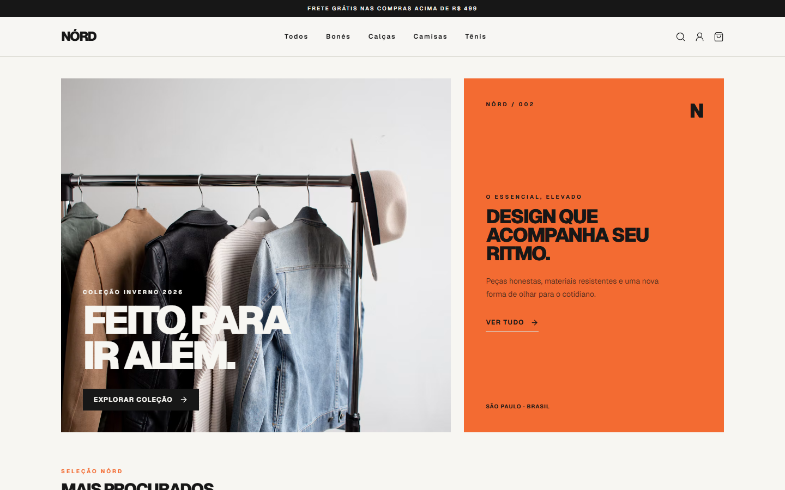
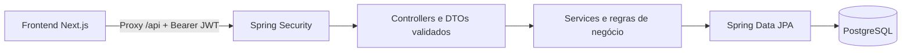

<div align="center">

# Nord · API de e-commerce

**Backend da NÓRD: autenticação, catálogo, carrinho, pedidos e administração com PostgreSQL.**


[](https://github.com/ezequieldesr/nord_backend/actions/workflows/security.yml)

[Funcionalidades](#funcionalidades) · [Executar](#executar-localmente) · [Endpoints](#api-em-resumo) · [Testes](#testes) · [Frontend](https://github.com/ezequieldesr/nord_frontend)

</div>

## O projeto

Nord é uma API REST desenvolvida como projeto pessoal de portfólio. A aplicação representa a operação
de uma loja de moda: o cliente encontra produtos, monta um carrinho e registra um pedido;
o administrador gerencia catálogo, usuários e etapas de entrega.

Os pedidos são demonstrativos: não há gateway de pagamento nem cobrança.
Este repositório contém o backend; a experiência visual está no
[nord_frontend](https://github.com/ezequieldesr/nord_frontend), desenvolvido em Next.js.

## Veja funcionando

[](https://github.com/ezequieldesr/nord_frontend/blob/main/docs/demo/nord-demo.mp4)

**[▶ Vídeo da jornada de compra](https://github.com/ezequieldesr/nord_frontend/blob/main/docs/demo/nord-demo.mp4)** ·
**[▶ Vídeo da gestão administrativa](https://github.com/ezequieldesr/nord_frontend/blob/main/docs/demo/nord-admin.mp4)**

As demonstrações foram gravadas por testes Playwright com frontend, API e PostgreSQL reais rodando localmente.
Os vídeos e o [roteiro executável](https://github.com/ezequieldesr/nord_frontend/blob/main/docs/ROTEIRO-DEMONSTRACAO.md)
estão no repositório do frontend. Os links estarão disponíveis no GitHub após o envio dos respectivos arquivos.

<details>
<summary><strong>📷 Ver painel administrativo integrado</strong></summary>


O painel fica em `/admin` no frontend. Toda operação administrativa exige autorização no backend.

</details>

## Funcionalidades

| Área | Comportamento |
| --- | --- |
| Autenticação | Cadastro de CLIENTE, login, BCrypt e JWT com validade |
| Catálogo | Consulta pública; gestão de produtos, preços, estoque, tamanhos e categorias por ADMIN |
| Imagens | Nove imagens de catálogo incluídas, expostas por uma rota com lista de arquivos permitidos |
| Carrinho | Persistência por usuário, quantidade, remoção e total calculado pelo servidor |
| Endereços | Cadastro, consulta, alteração e exclusão limitados ao proprietário |
| Checkout | Pedido transacional, validação de estoque e tamanhos, baixa de estoque e esvaziamento do carrinho |
| Histórico | Itens e endereço copiados no momento da compra, consulta dos próprios pedidos |
| Administração | Lista de pedidos e atualização de status sem retrocesso |
| Usuários | Listagem paginada, edição, permissões, desativação e exclusão de contas sem pedidos |
| Sessões | Alterações administrativas invalidam tokens; contas desativadas perdem acesso |

## Arquitetura



Controllers recebem contratos validados; services aplicam regras e transações; repositories persistem os dados.
Produtos usam versionamento otimista para detectar conflitos concorrentes de estoque.
A propriedade dos recursos deriva do usuário autenticado, sem aceitar um usuário arbitrário no corpo do pedido.

## Executar localmente

### Pré-requisitos

- Java 17 e Maven 3.9+.
- Docker Desktop com Compose, ou um PostgreSQL configurado manualmente.
- Node.js 24 e pnpm para executar também o frontend.

### 1. Clonar os projetos

```bash
git clone https://github.com/ezequieldesr/nord_backend.git
git clone https://github.com/ezequieldesr/nord_frontend.git
```

### 2. Banco e API — terminal 1

```bash
cd nord_backend
docker compose up -d db
mvn spring-boot:run "-Dspring-boot.run.profiles=dev"
```

O Compose sobe apenas o banco em `127.0.0.1:5432`, com volume persistente.
O perfil `dev` usa `loja_db`, usuário `postgres` e senha local `admin`.
Ele cria categorias e nove produtos quando o banco está vazio e completa imagens ausentes dos produtos conhecidos.
Também cria um administrador local, se o e-mail ainda não existir.

<details>
<summary><strong>Administrador e configuração na IDE</strong></summary>

Conta exclusivamente local: `admin@loja.com` / `admin12345`.
O painel é aberto no frontend: http://localhost:3000/admin.
Não reutilize essas credenciais em produção.

Na IDE, defina `SPRING_PROFILES_ACTIVE=dev`.
O perfil padrão é `prod`; sem essa opção, serão exigidos `JWT_SECRET` e as variáveis do banco.
A configuração compartilhada do IntelliJ está em `.run/Nord Local.run.xml`.

</details>

<details>
<summary><strong>PostgreSQL próprio, sem Docker</strong></summary>

Crie `loja_db` em seu PostgreSQL e configure a conexão de desenvolvimento.
Se necessário, sobrescreva `SPRING_DATASOURCE_URL`, `SPRING_DATASOURCE_USERNAME` e `SPRING_DATASOURCE_PASSWORD`.
Não execute dois bancos na mesma porta. Não apague volumes existentes para resolver um erro de configuração.

</details>

### 3. Frontend — terminal 2

Na pasta `nord_frontend`, copie `.env.example` para `.env.local`:

```powershell
Copy-Item .env.example .env.local
```

Em Linux/macOS use `cp .env.example .env.local`.
Mantenha `NORD_API_URL=http://127.0.0.1:8080` e execute:

```bash
pnpm install --frozen-lockfile
pnpm dev
```

| Serviço | URL |
| --- | --- |
| Loja | http://localhost:3000 |
| Administração | http://localhost:3000/admin |
| Catálogo da API | http://localhost:8080/api/produtos |

A raiz da API em `:8080/` retorna 404: a interface é servida pelo Next.js.
Os arquivos antigos em `src/main/resources/static` não são incluídos no JAR nem servidos pela aplicação.
Para testar o sistema completo, mantenha **PostgreSQL + API + frontend** em execução.

## API em resumo

Prefixo `/api`. Autenticação: `Authorization: Bearer <token>` obtido no cadastro ou login.

| Métodos | Rota | Acesso |
| --- | --- | --- |
| POST | `/auth/registrar`, `/auth/login` | Público |
| GET | `/produtos`, `/produtos/{id}`, `/categorias` | Público |
| GET | `/catalogo/imagens/{arquivo}` | Público; arquivos permitidos |
| POST | `/produtos`, `/categorias` | ADMIN |
| PUT, DELETE | `/produtos/{id}`, `/categorias/{id}` | ADMIN |
| GET | `/usuarios/me` | Autenticado |
| GET | `/carrinho` | Próprio usuário |
| POST | `/carrinho/itens` | Próprio usuário |
| PUT, DELETE | `/carrinho/itens/{itemId}` | Próprio usuário |
| GET, POST | `/enderecos` | Próprio usuário |
| PUT, DELETE | `/enderecos/{id}` | Próprio usuário |
| POST | `/pedidos` | Próprio usuário |
| GET | `/pedidos/meus` | Próprio usuário |
| GET | `/admin/pedidos` | ADMIN |
| PATCH | `/admin/pedidos/{id}/status` | ADMIN |
| GET | `/admin/usuarios?page=0` | ADMIN; 20 registros por página |
| PUT, DELETE | `/admin/usuarios/{id}` | ADMIN |

<details>
<summary><strong>Exemplo de login e resposta de erro</strong></summary>

```http
POST /api/auth/login
Content-Type: application/json

{"email":"cliente@example.com","senha":"sua-senha"}
```

A resposta contém o token, ID, nome, e-mail e permissão. Não exponha o token em capturas ou logs públicos.
Os erros usam o formato:

```json
{
  "status": 400,
  "mensagem": "Confira os campos enviados.",
  "erros": { "campo": "Descrição do problema" }
}
```

`erros` é opcional. 401 indica falta de autenticação; 403, permissão insuficiente;
404, recurso não encontrado; 409, conflito; 429, limite de tentativas.

</details>

## Testes

```bash
mvn -B -ntp verify
```

A suíte backend possui **48 testes** sobre regras de negócio, JWT, validação e acesso aos endpoints.
A execução não precisa de um PostgreSQL ativo: os testes isolados utilizam mocks.
O workflow [Backend verification](https://github.com/ezequieldesr/nord_backend/actions/workflows/security.yml)
executa `verify` em pushes e pull requests.

No frontend, com os três serviços locais ligados:

```bash
pnpm exec playwright install chromium
pnpm test:e2e
pnpm demo:record
```

Os **quatro cenários E2E** verificam compra, gestão, acesso em celular e restrições da API contra o PostgreSQL real.
A suíte frontend também possui 12 testes de contratos e sessões.
[Evidência resumida da gravação](docs/demo/verification.json).
Os testes E2E criam dados fictícios e consomem estoque; use banco local dedicado.

## Configuração de produção

| Variável | Finalidade |
| --- | --- |
| `SPRING_PROFILES_ACTIVE=prod` | Perfil de produção |
| `DB_URL` | URL JDBC, como `jdbc:postgresql://host:5432/banco` |
| `DB_USER`, `DB_PASSWORD` | Credenciais do banco |
| `JWT_SECRET` | Segredo Base64 aleatório com pelo menos 32 bytes decodificados |
| `JWT_EXPIRATION_MS` | Validade do JWT; padrão 7200000 ms |
| `ADMIN_EMAIL`, `ADMIN_PASSWORD` | Criação inicial opcional do administrador |
| `CORS_ORIGINS` | Origens exatas autorizadas para chamadas diretas do navegador |
| `PORT` | Porta HTTP fornecida pela hospedagem, padrão 8080 |

Gere o segredo com `openssl rand -base64 48`; não publique o resultado.
O Dockerfile compila, executa testes e usa um usuário sem privilégios no container final.
O perfil `prod` não cria o catálogo demonstrativo: cadastre produtos pelo painel.
O frontend precisa de `NORD_API_URL` com a URL da API antes de seu build.

[Guia de implantação Render + Vercel](docs/DEPLOY-RENDER-VERCEL.md).
Hospedagem não é necessária para executar ou gravar a demonstração local.

## Limites e evolução

O projeto não é uma plataforma comercial pronta. Pagamento, frete e logística são demonstrativos;
não há recuperação de senha ou verificação de e-mail. Valores monetários ainda usam `Double`;
a evolução recomendada é `BigDecimal` com regras explícitas de arredondamento.
O schema usa `ddl-auto=update`; migrações versionadas, backups testados e monitoramento são próximos passos.

Há limite de tentativas de login em memória; ele não é compartilhado entre réplicas e não constitui proteção
completa contra abuso ou DDoS. Logout no frontend remove a sessão local; os tokens expiram ou são invalidados
por alterações administrativas. Testes aprovados não garantem ausência de vulnerabilidades.

## Organização

```text
src/main/java/com/nord/nord/
  controller/   Endpoints públicos, autenticados e administrativos
  dto/          Contratos e validação de entrada/saída
  service/      Regras de negócio e transações
  repository/   Acesso ao banco
  model/        Entidades e permissões
  security/     Autenticação, JWT, autorização e limite de login
  config/       Inicialização de administrador e dados locais
src/main/resources/catalogo/imagens/  Imagens dos produtos de demonstração
src/test/                            Testes backend
docs/                                Guias e evidências públicas
```

## Autor

[Ezequiel — GitHub](https://github.com/ezequieldesr)

[Voltar ao início](#nord--api-de-e-commerce)
